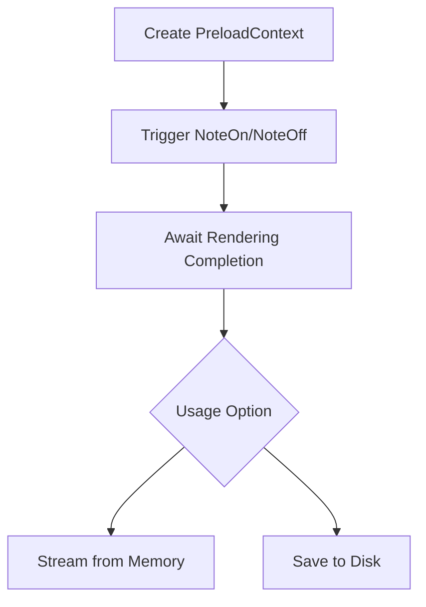
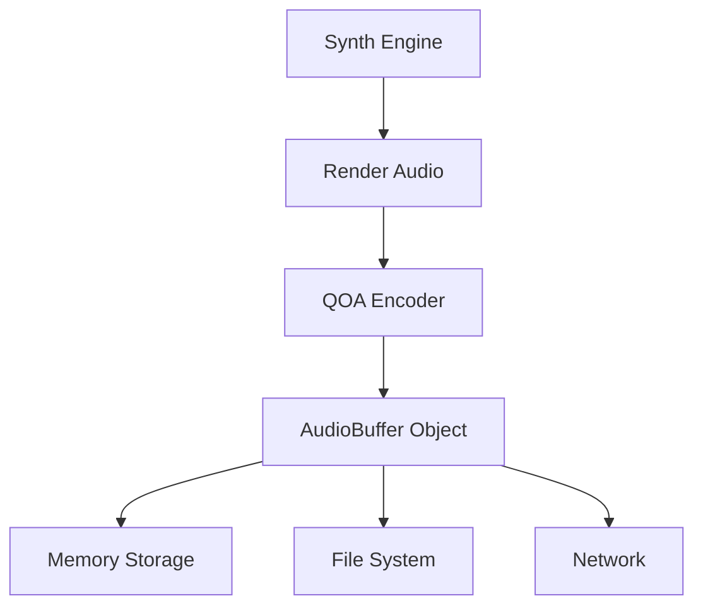
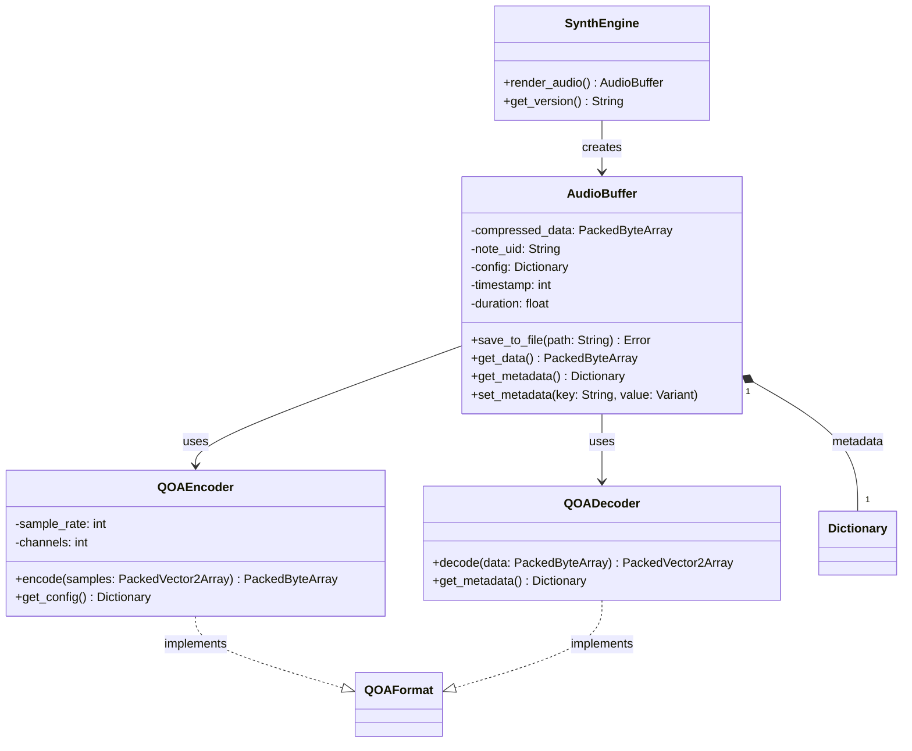

# QOA Audio Compression / Note Preloading (design notes)

> Migrated from cline's `.cline_brain/` (March 2025). Not yet implemented beyond vendoring `src/synth/ext/qoa.h`.

---

## QOA Audio Compression Implementation Plan

## Core Requirements

- Implement QOA encoder only (decoder not needed)
- Work with in-memory buffers (no file I/O required)
- Support both:
  - Immediate playback from compressed buffer
  - Optional disk saving (user decision)

## Class Structure

### PreloadNoteContext

- Manages offline rendering pipeline
- Provides async completion tracking
- Handles compressed buffer access

### QOAEncoder Responsibilities

- Process PCM frames to QOA format
- Manage compression state
- Provide compressed buffer access

## User Flow Diagram



## Key Methods

1. `create_preload_context()` - Creates offline rendering context
2. `await_rendering()` - Async completion check
3. `get_compressed_buffer()` - Returns QOA data with metadata
4. `clear_preload_context()` - Releases resources

---

## Revised QOA Audio Compression Implementation Plan

## Overview

Integrate QOA (Quite OK Audio) compression for rendering synthesized audio with flexible output handling.

## Architecture



## Implementation Steps

1. **QOA Integration**
   - Add qoa.h to src/synth/ext/
   - Create AudioBuffer resource class in Godot

2. **Godot Bindings**

   ```cpp
   class AudioBuffer : public Resource {
       GDCLASS(AudioBuffer, Resource);
       
       PackedByteArray compressed_data;
       String note_uid;
       Dictionary config;
       
       static void _bind_methods();
       
   public:
       Error save_to_file(String path);
       PackedByteArray get_data() const;
       // Additional metadata methods
   };

   class SynthEngine {
       Ref<AudioBuffer> render_audio(/* params */);
   };
   ```

3. **Key Features**
   - Memory-first design
   - Metadata support (note UID, config)
   - Optional file persistence
   - Network streaming capability

4. **Testing Strategy**
   - Memory usage benchmarks
   - Round-trip encode/decode tests
   - Metadata integrity checks

---

## QOA Audio System UML Diagram



## Key Relationships

1. **SynthEngine** creates **AudioBuffer** instances when rendering
2. **AudioBuffer** manages both compression and metadata
3. Encoder/Decoder implement QOA format specification
4. Metadata stored as key-value pairs in Dictionary
